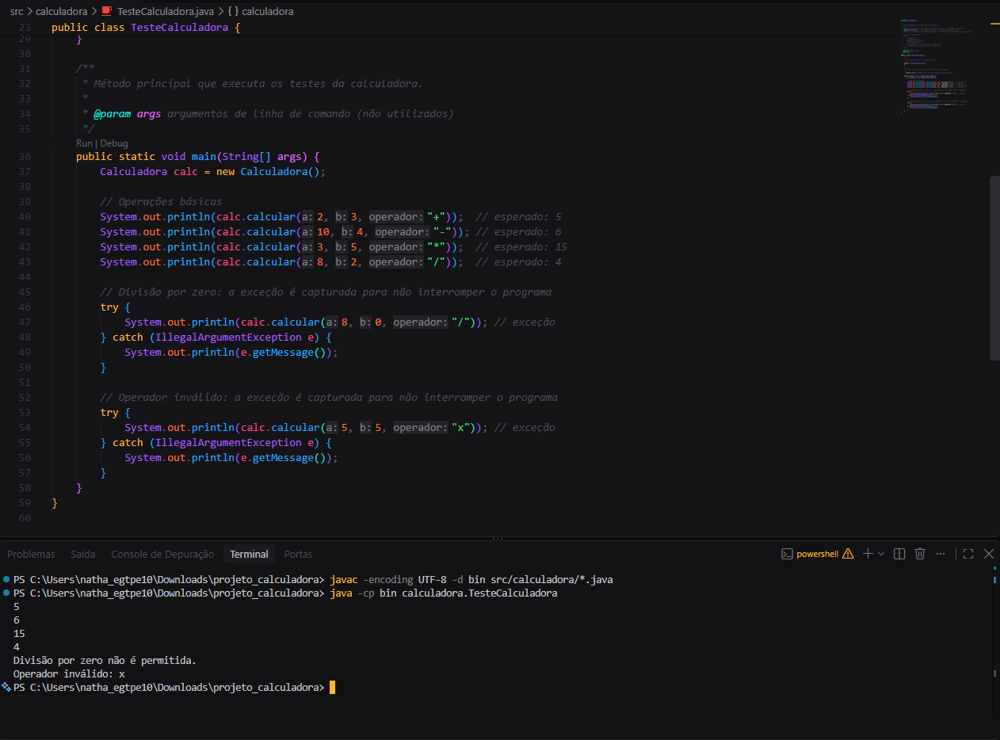
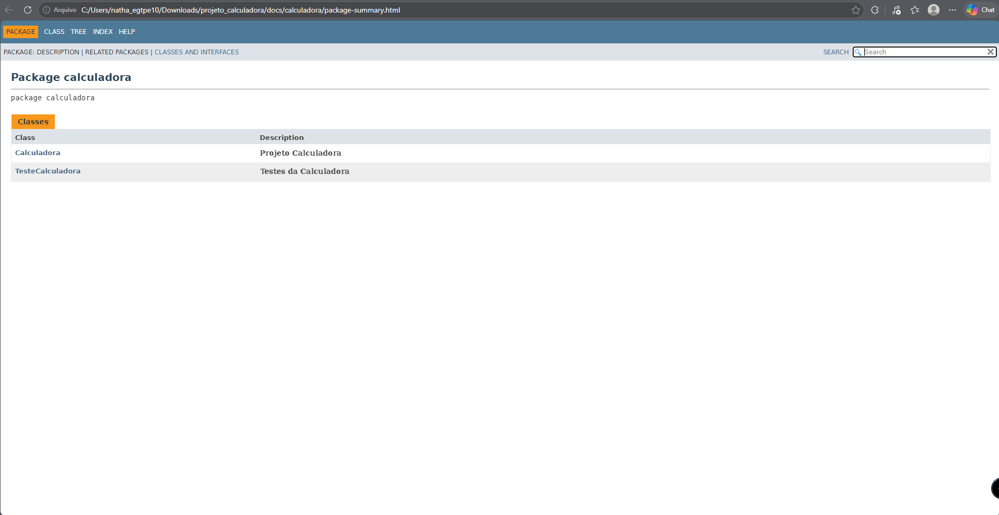
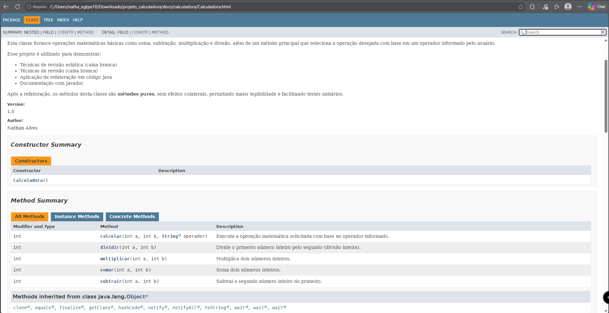

# projeto_calculadora

## Descrição do Projeto

Módulo básico de cálculos matemáticos desenvolvido em Java para a startup fictícia **FinançApp**, que está criando um aplicativo mobile de controle de finanças pessoais. A classe `Calculadora` serve como motor de cálculos para funcionalidades como orçamento mensal, divisão de despesas e projeção de economia.

O projeto passou por um ciclo completo de qualidade de software: implementação inicial, testes unitários, refatoração, documentação com JavaDoc e versionamento no GitHub.

## Objetivo da Atividade

Aplicar na prática os conceitos de:

- testes funcionais e testes unitários;
- tratamento de erros;
- refatoração de código;
- documentação técnica (JavaDoc);
- versionamento de software (Git e GitHub).

## Tecnologias Utilizadas

- **Java** (JDK 21+; o `switch` com `->` exige Java 14 ou superior)
- **JavaDoc** para geração da documentação em HTML
- **Git** para versionamento
- **GitHub** como repositório remoto
- **VS Code** como editor

## Estrutura do Projeto

```
projeto_calculadora/
├── docs/                      # documentação JavaDoc gerada (abrir docs/index.html)
├── prints/                    # prints da execução dos testes e da documentação
├── src/
│   └── calculadora/
│       ├── Calculadora.java       # classe com as operações
│       └── TesteCalculadora.java  # classe de testes
└── README.md
```

## Branches

| Branch | Conteúdo |
|---|---|
| `main` | Implementação inicial: método `calc(int a, int b, String op)` com `if/else` e atributo `r` |
| `Refatoracao` | Código refatorado, documentado com JavaDoc e com a pasta `docs/` gerada |

## Explicação das Operações

Na versão refatorada, cada operação virou um método próprio, e o método `calcular` escolhe qual chamar a partir do operador:

| Operador | Método | Descrição | Exemplo |
|---|---|---|---|
| `+` | `somar(a, b)` | Soma dois números inteiros | `calcular(2, 3, "+")` → `5` |
| `-` | `subtrair(a, b)` | Subtrai `b` de `a` | `calcular(10, 4, "-")` → `6` |
| `*` | `multiplicar(a, b)` | Multiplica dois números inteiros | `calcular(3, 5, "*")` → `15` |
| `/` | `dividir(a, b)` | Divisão inteira de `a` por `b` | `calcular(8, 2, "/")` → `4` |

### Tratamento de Erros

- **Divisão por zero:** `dividir` lança `IllegalArgumentException` com a mensagem *"Divisão por zero não é permitida."*
- **Operador inválido:** `calcular` lança `IllegalArgumentException` com a mensagem *"Operador inválido: x"*.
- Nos testes, as duas exceções são capturadas com `try/catch`, então o programa exibe a mensagem e **continua executando**, sem interromper a aplicação.

## Refatoração

Técnicas aplicadas na branch `Refatoracao`:

- **Extração de métodos:** cada operação (`somar`, `subtrair`, `multiplicar`, `dividir`) virou um método separado.
- **Melhoria nos nomes:** `calc` → `calcular` e `op` → `operador`.
- **Simplificação das condicionais:** a cadeia de `if/else if` foi substituída por um `switch` com `->`.
- **Organização lógica:** o atributo `r` e os `System.out.println` saíram da classe; os métodos agora são puros (só recebem e retornam valores), o que facilita os testes.
- **Tratamento de erros por exceção:** em vez de imprimir uma mensagem e retornar `0`, a classe lança `IllegalArgumentException`, deixando para quem chama decidir como exibir o erro.

Após a refatoração, todos os testes foram executados novamente e os resultados das operações continuaram corretos.

## Testes

A classe `TesteCalculadora` executa os seguintes casos:

| Caso | Entrada | Resultado esperado | Resultado obtido |
|---|---|---|---|
| Soma | `calcular(2, 3, "+")` | `5` | `5` |
| Subtração | `calcular(10, 4, "-")` | `6` | `6` |
| Multiplicação | `calcular(3, 5, "*")` | `15` | `15` |
| Divisão | `calcular(8, 2, "/")` | `4` | `4` |
| Divisão por zero | `calcular(8, 0, "/")` | Mensagem de erro | `Divisão por zero não é permitida.` |
| Operação inválida | `calcular(5, 5, "x")` | Mensagem de erro | `Operador inválido: x` |

### Como executar

Na raiz do projeto:

```bash
javac -encoding UTF-8 -d bin src/calculadora/*.java
java -cp bin calculadora.TesteCalculadora
```

### Print da execução dos testes



## Documentação JavaDoc

As classes, métodos, parâmetros, retornos e exceções foram documentados com JavaDoc, usando as anotações `@author`, `@version`, `@param`, `@return` e `@throws`.

Para gerar a documentação, dentro da pasta `src`:

```bash
javadoc -encoding UTF-8 -docencoding UTF-8 -charset UTF-8 -author -version -d ../docs calculadora/*.java
```

A documentação gerada fica em `docs/`. Para visualizar, abra `docs/index.html` no navegador.

### Prints da documentação





## Link do Repositório

https://github.com/NathanDotAlves/projeto_calculadora

## Autor

Nathan Alves
